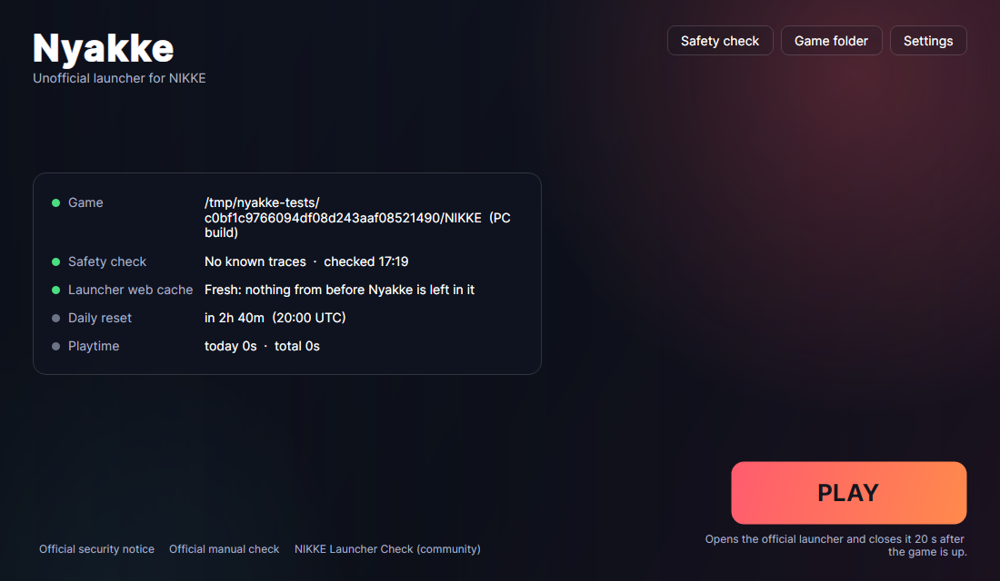

# Nyakke

An unofficial launcher for NIKKE on PC, written in C# for .NET 10 with Avalonia. It is not
part of the emulator in this repository and is not built with it.



## What it does

NIKKE gets its sign-in from the official launcher, so no other program can replace that
launcher. Nyakke starts it for you and keeps it on a short leash:

- **Check before each start.** A read-only look for the known traces of the November 2026
  compromise of the official launcher (the "k2f" agent): lines in `debug.log`, compiled Lua in
  the launcher's log folder, the Chrome DLL and its registry entry, entries in the launcher's
  web cache, leftovers in the temp folder. If something is found, Nyakke does not start the
  launcher by itself and shows what and where. It deletes none of it.
- **Old web cache out of the way.** On the first start the launcher's `tbs_cache` folder is
  moved aside (kept as a backup next to it), so scripts cached before the fix cannot load again.
- **Launcher closed once the game is up.** 20 seconds after `nikke.exe` appears, the launcher
  is asked to close and, if it does not, ended. It no longer sits in the tray for hours.
- **Tripwire while the launcher is open.** If a file that starts like compiled Lua appears in
  `Launcher\log`, which is how the agent arrived, every launcher process is ended at once and a
  copy of the file is kept in Nyakke's data folder.
- Daily reset countdown, playtime, your own background picture and name, links to the official
  notices.

Nyakke itself never uses the network, has no embedded browser and does not update itself.

## Limits

- This shortens the time the official launcher runs and trips on the one known attack. It is
  not an antivirus and cannot make a compromised launcher safe. A clean check is not proof of
  a clean PC: use Level Infinite's manual check (linked in the window) as well.
- Third-party tools are used at your own risk. Nyakke starts only the official programs and
  changes no game or anti-cheat file.
- "Start nikke.exe itself" in Settings is an experiment. The game is expected to refuse to
  sign in without the launcher.

## Build and run (Windows)

Install the [.NET 10 SDK](https://dotnet.microsoft.com/download), then:

```bash
publish.cmd
```

The program is `dist\Nyakke\Nyakke.exe`. Settings, logs and playtime are in
`%LOCALAPPDATA%\Nyakke`. Avalonia sends anonymous build statistics unless
`AVALONIA_TELEMETRY_OPTOUT=1` is set.

Windows asks for administrator rights at Play when the official launcher itself requires them:
a small windowless copy of Nyakke (the session agent) then starts the launcher and is allowed to
close it. The window never runs as administrator.

## Tests

```bash
dotnet test tests/Nyakke.Tests
```

`tests/e2e-wine.sh` runs the Windows build of the session agent under Wine against stand-in
programs for the launcher and the game (needs mingw-w64, Wine and xvfb).

## What was and was not tested

Tested on Linux: the unit tests, the windows (rendered without a screen), and the session agent
as a Windows build under Wine with stand-ins. Not tested: a real Windows PC, the real launcher
and the real game. The install layout, process names and traces come from public write-ups of
the incident and from community tools. If something does not fit your install, send
`%LOCALAPPDATA%\Nyakke\nyakke.log` and `agent.log`.
